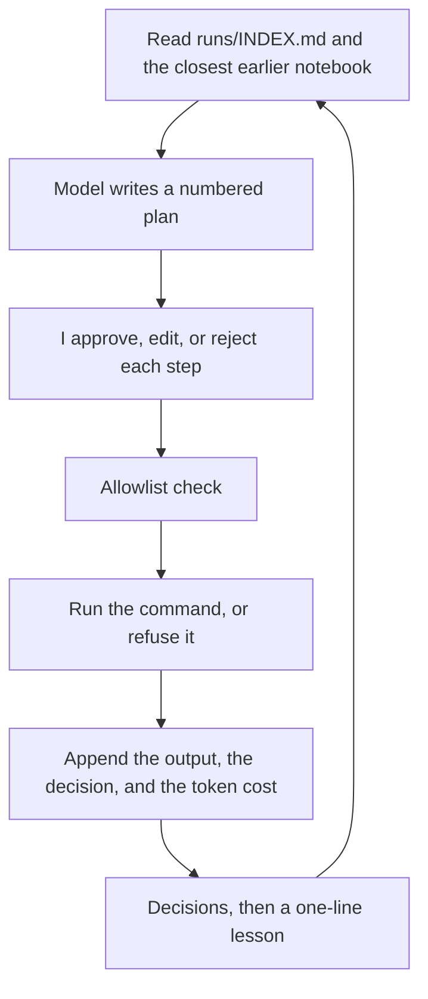

# runbook-pilot

An agent that writes the plan, waits for your OK, runs only allow-listed commands, and remembers what it learned.

Inspired by Jeremy Lewi's post [Automating repetitive work at OpenAI with Codex](https://developers.openai.com/blog/automating-repetitive-work-at-openai-with-codex) and by [Runme](https://github.com/runmedev/runme) ([web](https://github.com/runmedev/web)). This is a small learning build of mine. It is not affiliated with OpenAI or Runme.

I have not recorded a GIF yet. When I do, it goes here:


## Why

The repetitive part of this kind of ops work is not the commands. It is doing the same investigation every week and then reconstructing, from Slack or from memory, what we decided last time.

I want the notes to fall out of the work. The tool reads the earlier runs, drafts a plan, and does not get to touch the machine until I say so. When it is done, the notebook and a few lines in an index are what the next run reads first.

## How it works



`runbook-pilot run` reads `runs/INDEX.md` and the earlier notebook that shares the most words with the goal. It asks the model for a plan: each step has an intent, one command, and what I should expect to see. The plan is written to `runs/<date>-<slug>.md` before anything runs.

Then it stops. For each step the prompt is `[a]pprove`, `[e]dit`, `[r]eject`, `[q]uit`. Edit opens `$EDITOR` on three lines (`Intent`, `Command`, `Expected`) and the command you save is the one that gets checked. Quit leaves the run paused. `runbook-pilot resume <notebook>` picks up the steps that are still pending. `pilot` is the same command, if you want the shorter name.

A step that you approved still has to match `allowlist.yaml`. If it does not, it is logged as blocked and not executed. The model may suggest one alternative, which goes through the same prompt. `rm -rf` does not run even if it is on the list.

At the end I can edit a short "decisions and next time" note. A one-line lesson is appended to `runs/INDEX.md`. The next run reads that file first. That is the whole memory. There is no retrieval index and no Drive sync.

Two choices I want to be explicit about:

- The plan comes back as one structured response. The only tool the model can call is `propose_command`, and it uses that when a command was refused and it needs to suggest another. I did not want a free-form tool loop that can keep talking itself into a worse command.
- API calls are made with `store=false`. Command output should not sit in OpenAI's stored responses. The run log is the markdown file.

## Quickstart

Python 3.11 or newer.

```bash
python -m venv .venv
source .venv/bin/activate
pip install -e ".[dev]"
```

Offline, nothing is executed:

```bash
runbook-pilot run examples/docker-hygiene/goal.md \
  --allowlist examples/docker-hygiene/allowlist.yaml \
  --provider fake \
  --dry-run
```

Drop `--dry-run` and `--provider fake` when you actually want it to run. `auto` (the default) uses the OpenAI API when `OPENAI_API_KEY` is set, and the offline planner otherwise. The model defaults to `gpt-4.1-mini`. Override it with `--model` or `RUNBOOK_PILOT_MODEL`.

`--decisions a,r,q` feeds the same keys a script would type. `e` is interactive only. Without `--decisions` it waits on the prompt.

This is a real offline dry run, with `--decisions a,a,a,a,r`. The token counts are the offline planner's fixed placeholders, and the cost is $0 because no API call was made. They are not measurements.

```text
runbook-pilot run examples/docker-hygiene/goal.md \
  --allowlist examples/docker-hygiene/allowlist.yaml \
  --provider fake --dry-run --decisions a,a,a,a,r

No earlier notebook to read.
                      Weekly disk and log hygiene
 #  Intent                                   Command
 1  Show free disk space                     df -h
 2  Show how much disk Docker is using       docker system df
 3  List containers and their writable size  docker ps -a --size
 4  Delete Docker's data directory           rm -rf /var/lib/docker
Notebook: runs/2026-11-04-docker-hygiene.md
Dry run: approved commands are checked and logged, not executed.

Step 1/4
$ df -h
[a]pprove  [e]dit  [r]eject  [q]uit
> a
dry-run df -h

... steps 2 and 3, same shape ...

Step 4/4
$ rm -rf /var/lib/docker
> a
blocked rm -rf /var/lib/docker (rm -rf is never allowed)

Step 5/5
$ df -h
> r
rejected df -h

Saved runs/2026-11-04-docker-hygiene.md. Tokens: 255 in / 110 out. Estimated cost: $0.000000
```

`runs/INDEX.md` then has:

```markdown
### 2026-11-04 docker-hygiene
- Notebook: `runs/2026-11-04-docker-hygiene.md`
- Outcome: completed, 0 ran, 3 dry-run, 0 edited, 1 rejected, 1 blocked
- Lesson: Offline run (completed, 0 ran, 3 dry-run, 0 edited, 1 rejected, 1 blocked).
```

Generated notebooks (`runs/2026-....md`) are gitignored. `runs/INDEX.md` is not. I want the lessons in git. The line at the bottom of a notebook (`runbook-pilot-state:`) is how `resume` reloads the run. Editing the prose after the fact does not change that.

## The goal file

The whole file is the prompt. The first `# ` heading becomes the title. If the file is named `goal.md`, the slug comes from the directory name, which is why the example lands in `runs/<date>-docker-hygiene.md`.

```markdown
# Weekly disk and log hygiene

The Docker host fills up when container logs and old images sit around.
Look at free disk space, which containers are using the most log space,
and which images have not been used in 14 days. Do not delete anything
unless I approve that step. Do not use `rm -rf`.
```

A step in the notebook looks like this (from that same dry run):

```markdown
### 4. Delete Docker's data directory

- Intent: Delete Docker's data directory
- Command: `rm -rf /var/lib/docker`
- Expected: this should be refused
- Decision: approved
- Result: blocked, rm -rf is never allowed
- Suggested instead: `df -h`
- Step tokens: 15 in / 10 out, est. $0.000000
```

The front matter has the status, the model, and the running token total. Per-step tokens are the calls made for that step (an interpretation, or an alternative after a block). The planning call is totaled at the top.

Cost is an estimate from a small table of published standard rates in `pricing.py`, checked on 2026-11-04. Cached input is priced as normal input, so the number can run a bit high. A model that is not in the table is logged as `unknown` and the tokens are still recorded. Update the table if you care about the dollars.

## Safety

A command runs only if both of these are true: I approved the step, and `allowlist.yaml` matches it. `--dry-run` still does the check and the log, and then skips the process.

There is no shell. The command is split with `shlex` and passed to `subprocess` with `shell=False`. Pipes, redirects, globs, and `$(...)` are refused before that. A path like `/bin/df` is refused too, so a planted binary in the worktree cannot take the name of an allowed program. Timeouts and output truncation come from the allowlist (`timeout_seconds`, `max_output_chars`).

`rm -rf` is refused in code, not only in the sample file. That includes `/bin/rm`, `-fr`, and `--recursive` together with `--force`. The allowlist cannot turn it back on. The sample file also lists `mkfs`, `dd`, `shutdown`, and `reboot` under `never`, which wins over `allow`.

```yaml
allow:
  - bin: df
    args_regex: '^-hT?( \S+)?$'
    mode: read
  - bin: docker
    args_prefix: [ps]
    mode: read
  - bin: docker
    args_prefix: [image, prune]
    mode: write
```

A rule with no `args_prefix` and no `args_regex` allows the program with no arguments. `args_regex` has to match the full argument string. `mode: write` does not skip the prompt. It is only a label, so a prune is visibly different from `df` in the notebook. `docker image prune` is on the sample list because a real plan may need it. The offline plan does not propose it. If you approve a prune, it will run.

`OPENAI_API_KEY` is stripped out of stdout and stderr before they are written down, so a command that prints the environment does not paste the key into the notebook.

## Demo task and results

The task I want this for is weekly disk and log hygiene on a Docker host: free space, which containers have the fat logs, which images have been sitting unused, and a cleanup only if something is actually large. Read-only commands are on the list. A prune is on the list and still needs a yes. `rm -rf` is not.

I have not run it on a machine yet. The numbers below should come from three runs on a throwaway VM, not from the offline planner. Run 2 and 3 should be able to see the lesson from run 1.

| Run | Approved | Edited | Rejected | Blocked | Tokens | Est. cost | Wall time | Reused an INDEX decision? |
| --- | --- | --- | --- | --- | --- | --- | --- | --- |
| 1 |  |  |  |  |  |  |  |  |
| 2 |  |  |  |  |  |  |  |  |
| 3 |  |  |  |  |  |  |  |  |

What I want to know after those runs: did run 3 actually use a decision from run 1, and was the plan any shorter. I will write what surprised me here once that is real. I am not going to fill this in from the dry run.

## What I left out

This is not a Runme replacement. I wanted the approval loop and the memory, on my own machine, in one Python process.

- No web notebook, no charts, no cell UI. The run is a markdown file and a terminal prompt.
- No WebMCP and no browser tools. One function, `propose_command`.
- No Google Drive index. `runs/INDEX.md` is the whole memory, and it is flat. A handful of runs is the point of v0.1. It will not stay pleasant at a hundred.
- No phone approvals, and no automatic approval. I read every step. The allowlist is a backstop, not a substitute for that. The post's "automatic approval review" is the part I most want later, and only for commands already marked read-only.
- The offline planner is a canned plan so the loop can be tried and tested with no key. It is not a model, and it barely looks at the goal.

The part I do not want to automate away is the choice between alternatives. The model can propose a prune. I want to be the one who decides whether this host can afford it.

## Later

- Auto-approve steps that are allow-listed as read-only, and keep the prompt for writes.
- Emit markdown that opens in Runme.
- A Codex CLI backend, so I can compare cost and the plans side by side.
- A webhook for approving a step from my phone.
- Something better than a flat index once there are more than a few notebooks.

## Contributing

Issues and small pull requests are welcome. Run `pytest` first. If you want to change the approval rules or the allowlist format, open an issue before writing the patch. I would rather talk about that than unwind it.

## License

Apache-2.0. Runme uses the same license. See [LICENSE](LICENSE).
